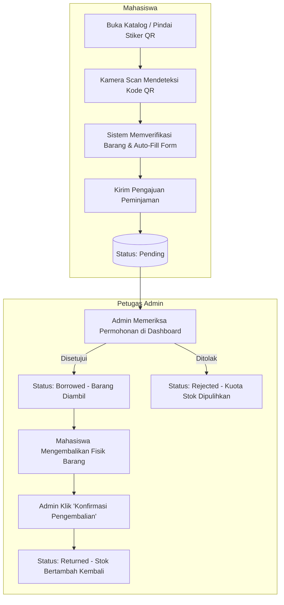

# 🎓 PinjamKampus — Sistem Peminjaman Inventaris Mandiri Kampus (QR Code)

[](https://laravel.com)
[](https://php.net)
[](https://tailwindcss.com)
[](https://vitejs.dev)
[-success?style=flat&logo=phpunit&logoColor=white)](https://phpunit.de)
[](LICENSE)

**PinjamKampus** adalah aplikasi web modern berbasis **Laravel**, **Tailwind CSS v4**, dan **Vite** yang dirancang untuk mendigitalkan proses peminjaman sarana dan prasarana kampus (alat laboratorium, buku/modul perpustakaan, dan perlengkapan himpunan mahasiswa) secara mandiri dan cepat menggunakan **QR Code scanner terintegrasi**.

---

## 📌 Daftar Isi
- [Daftar Fitur Utama](#-fitur-utama)
- [Arsitektur & Teknologi](#-arsitektur--teknologi)
- [Prasyarat Sistem](#-prasyarat-sistem)
- [Panduan Instalasi & Menjalankan](#-panduan-instalasi--menjalankan)
- [Akun Demo Bawaan (Seeder)](#-akun-demo-bawaan-seeder)
- [Alur Kerja Sistem](#-alur-kerja-sistem)
- [Struktur Database](#-struktur-database)
- [Pengujian Otomatis (Testing)](#-pengujian-otomatis-testing)
- [Panduan Push ke GitHub](#-panduan-push-ke-github)
- [Lisensi](#-lisensi)

---

## ✨ Fitur Utama

### 👨‍🎓 Sisi Mahasiswa (Peminjam)
1. **Katalog Inventaris Real-Time:**
   - Jelajahi seluruh inventaris kampus dengan pencarian nama atau kode QR.
   - Filter berdasarkan kategori fasilitas (*Lab*, *Perpustakaan*, *Alat Himpunan*) dan status ketersediaan.
   - Indikator ketersediaan stok fisik berupa progress bar interaktif.
2. **Scan Mandiri (Self-Service QR Scanner):**
   - Pemindaian kamera langsung via browser perangkat (`html5-qrcode`).
   - Opsi unggah foto QR code dari galeri.
   - Opsi ketik kode QR manual dengan auto-fill form peminjaman otomatis.
3. **Riwayat Peminjaman:**
   - Pantau status pengajuan (*Menunggu Verifikasi*, *Sedang Dipinjam*, *Selesai Dikembalikan*, *Ditolak*).
   - Pengingat jatuh tempo otomatis dengan indikator sisa hari atau status terlambat (*overdue*).

### 🛡️ Sisi Administrator & Petugas Inventaris
1. **Dashboard Manajemen Terpadu:**
   - 4 Kartu statistik interaktif (*Menunggu Persetujuan*, *Sedang Dipinjam*, *Telah Dikembalikan*, *Total Jenis Barang*).
   - Bilah pencarian cepat (*Quick Search*) untuk mencari data mahasiswa berdasarkan NIM/Nama atau kode barang.
   - Tindakan cepat persetujuan (*approve*/*reject*) dan konfirmasi pengembalian langsung dari dashboard.
2. **Verifikasi Transaksi Peminjaman:**
   - Filter status transaksi komprehensif (*Semua*, *Menunggu*, *Dipinjam*, *Selesai*, *Ditolak*).
   - **Setujui Permohonan:** Mengubah status menjadi `borrowed`.
   - **Tolak Permohonan:** Mengubah status menjadi `rejected` dan otomatis mengembalikan stok barang ke inventaris.
   - **Konfirmasi Pengembalian:** Mengubah status menjadi `returned`, mencatat tanggal & jam pengembalian fisik, serta menambah kembali unit stok barang.
3. **Kelola Inventaris & Generator QR Code:**
   - Formulir tambah barang baru dengan sistem otomatis membuatkan kode unik QR (misal: `INV-LAB-A1B2`, `INV-LIB-C3D4`) atau kode kustom.
   - Ubah detail barang, kuota stok total, stok tersedia, dan status aset.
   - Proteksi keamanan: barang yang sedang aktif dipinjam tidak dapat dihapus sembarangan.
4. **Cetak Label Stiker QR Resmi (Print-Ready):**
   - Layout kartu stiker identitas resmi kampus dengan QR Code beresolusi tinggi.
   - Dilengkapi CSS cetak (`@media print`) sehingga stiker dapat langsung dicetak rapi pada kertas label/thermal tanpa gangguan elemen website.
5. **Pemisahan Peran Bersih:**
   - Halaman admin terisolasi dari menu scan peminjam untuk menjaga fokus alur kerja manajemen inventaris.

---

## 🛠️ Arsitektur & Teknologi

| Bagian | Teknologi | Keterangan |
| :--- | :--- | :--- |
| **Backend Framework** | Laravel 12 (PHP 8.2+) | MVC, Eloquent ORM, Middleware Auth & Role Admin |
| **Frontend Styling** | Tailwind CSS v4 | Antarmuka bersih, natural, dan responsif |
| **Asset Bundler** | Vite 8 + Laravel Vite Plugin | Hot Reloading & kompilasi instan |
| **QR Code Engine** | `html5-qrcode` & QR Server API | Pemindaian kamera browser & stiker cetak resolusi tinggi |
| **Database** | MySQL / MariaDB / SQLite | Relasi lengkap tabel `users`, `items`, `borrowings` |
| **Automated Testing** | PHPUnit Feature Tests | 35 Automated Tests (Coverage Auth, Admin, Scan, Catalog) |
| **Code Formatter** | Laravel Pint | Standar kode bersih PSR-12 |

---

## 💻 Prasyarat Sistem

Sebelum menginstal, pastikan komputer/server Anda telah terpasang:
- **PHP** >= 8.2 (dengan ekstensi `pdo`, `mbstring`, `openssl`, `tokenizer`, `xml`, `ctype`, `json`, `curl`, `gd`)
- **Composer** (Dependency manager PHP)
- **Node.js** >= 18 & **NPM**
- **Database Server** (MySQL, MariaDB, atau Laragon/XAMPP)

---

## 🚀 Panduan Instalasi & Menjalankan

Ikuti langkah-langkah berikut untuk menjalankan aplikasi di komputer lokal:

### 1. Kloning Repository
```bash
git clone https://github.com/username-anda/project-peminjaman.git
cd project-peminjaman
```

### 2. Pasang Dependensi PHP & JavaScript
```bash
composer install
npm install
```

### 3. Konfigurasi Lingkungan (`.env`)
Salin file `.env.example` menjadi `.env`:
```bash
cp .env.example .env
```
Lalu generate encryption key Laravel:
```bash
php artisan key:generate
```

Sesuaikan konfigurasi database pada file `.env` Anda:
```env
DB_CONNECTION=mysql
DB_HOST=127.0.0.1
DB_PORT=3306
DB_DATABASE=project_peminjaman
DB_USERNAME=root
DB_PASSWORD=
```

### 4. Jalankan Migrasi & Seeder Database
Jalankan perintah ini untuk membuat tabel database beserta akun demo dan data awal inventaris:
```bash
php artisan migrate --seed
```

### 5. Kompilasi Aset Frontend (Vite)
Untuk mode pengembangan (*development with hot-reload*):
```bash
npm run dev
```
Atau untuk membuat bundle produksi:
```bash
npm run build
```

### 6. Menjalankan Server Lokal
```bash
php artisan serve
```
Buka browser dan akses aplikasi melalui: **[http://localhost:8000](http://localhost:8000)** (atau domain virtual Laragon Anda).

---

## 🔑 Akun Demo Bawaan (Seeder)

Anda dapat langsung mencoba aplikasi menggunakan akun bawaan yang telah disediakan:

| Peran (Role) | Email Login | NIM / NIP | Password | Tujuan Halaman Login |
| :--- | :--- | :--- | :--- | :--- |
| **Petugas Admin** | `admin@kampus.ac.id` | `198503152010121002` | `password` | `/admin` (Dashboard Petugas Admin) |
| **Mahasiswa 1** | `samsi@mahasiswa.ac.id` | `220101001` | `password` | `/katalog` (Katalog & Scan Mandiri) |
| **Mahasiswa 2** | `budi@mahasiswa.ac.id` | `220101002` | `password` | `/katalog` (Katalog & Scan Mandiri) |
| **Mahasiswa 3** | `siti@mahasiswa.ac.id` | `220101003` | `password` | `/katalog` (Katalog & Scan Mandiri) |

> 💡 *Catatan: Form login juga menyediakan tombol **Pilih Akun Demo** sekali klik untuk pengisian cepat.*

---

## 🔄 Alur Kerja Sistem



---

## 🗄️ Struktur Database

### Tabel `users`
Menyimpan identitas pengguna (mahasiswa dan admin/petugas).
- `id` (PK)
- `name` (Nama lengkap)
- `email` (Email unik)
- `password` (Hashed password)
- `role` (`student`, `admin`)
- `nim_nip` (NIM Mahasiswa atau NIP Petugas, unik)

### Tabel `items`
Menyimpan data aset inventaris dan identitas kode QR.
- `id` (PK)
- `item_code` (Kode unik QR fisik, contoh: `INV-LAB-001`, `INV-LIB-042`)
- `name` (Nama peralatan/aset)
- `category` (`Lab`, `Perpustakaan`, `Alat Himpunan`)
- `total_stock` (Total kapasitas unit)
- `available_stock` (Sisa unit siap dipinjam)
- `status` (`available`, `empty`, `maintenance`)

### Tabel `borrowings`
Menyimpan catatan riwayat dan status transaksi peminjaman.
- `id` (PK)
- `user_id` (FK ke `users`)
- `item_id` (FK ke `items`)
- `borrow_date` (Tanggal pinjam)
- `due_date` (Batas tenggat pengembalian)
- `return_date` (Tanggal aktual saat barang dikembalikan fisik, nullable)
- `status` (`pending`, `borrowed`, `returned`, `rejected`)
- `notes` (Catatan keperluan peminjaman)

---

## 🧪 Pengujian Otomatis (Testing)

Aplikasi telah dilengkapi pengujian otomatis menyeluruh (*Unit & Feature Tests*) mencakup autentikasi, otorisasi peran, validasi stok, pencarian, dan transaksi peminjaman.

Jalankan test suite menggunakan perintah:
```bash
php artisan test
```

Hasil pengujian:
```text
   PASS  Tests\Feature\AdminTest
  ✓ student cannot access admin dashboard
  ✓ admin can access admin dashboard
  ✓ admin can view borrowings page
  ✓ admin can approve pending borrowing
  ✓ admin can reject pending borrowing and restore stock
  ✓ admin can confirm return and restore stock
  ✓ admin can view items management page
  ✓ admin can create item with auto generated qr code
  ✓ admin can update item
  ✓ admin can delete item
  ✓ admin can view print qr sticker
  ✓ admin cannot access scan page and is redirected to admin dashboard
  ✓ admin viewing catalog does not see scan button
  ✓ admin viewing item detail does not see scan loan button

   PASS  Tests\Feature\AuthTest
  ✓ login screen can be rendered
  ✓ users can authenticate using email
  ✓ users can authenticate using nim nip
  ✓ users can not authenticate with invalid password
  ✓ admin is redirected to admin dashboard even if visited catalog first
  ✓ authenticated admin visiting root is redirected to admin dashboard
  ✓ authenticated user can logout

   PASS  Tests\Feature\CatalogTest
   PASS  Tests\Feature\DatabaseSeederTest
   PASS  Tests\Feature\ScanAndBorrowTest

  Tests:    35 passed (102 assertions)
  Duration: 8.46s
```

Untuk memformat kode sesuai standar Laravel Pint:
```bash
php vendor/bin/pint --format agent
```

---

## 📤 Panduan Push ke GitHub

Ikuti instruksi berikut untuk mengunggah proyek ini ke akun GitHub Anda:

### 1. Inisialisasi Git di Komputer Lokal (jika belum)
```bash
git init
git branch -M main
```

### 2. Tambahkan Semua File dan Buat Commit Perdana
```bash
git add .
git commit -m "feat: inisialisasi sistem peminjaman kampus dengan panel admin dan scan qr"
```

### 3. Hubungkan ke Repository GitHub Anda
Buat repository baru di [GitHub](https://github.com/new), lalu tautkan URL repository tersebut:
```bash
git remote add origin https://github.com/USERNAME-ANDA/project-peminjaman.git
```

### 4. Push ke GitHub
```bash
git push -u origin main
```

---

## 📄 Lisensi

Proyek ini dirilis di bawah lisensi terbuka [MIT License](LICENSE). Bebas digunakan, dimodifikasi, dan dikembangkan untuk keperluan akademik maupun institusional.
